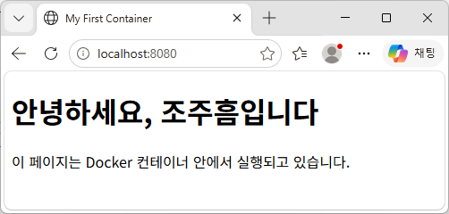

# Linux & Docker 실습 프로젝트

> Linux 터미널 조작부터 Docker 컨테이너 운영, Dockerfile 기반 커스텀 이미지 제작, 데이터 영속성 검증 및 GitHub 연동까지 수행하는 실습 프로젝트입니다.

---

## 1. 프로젝트 개요

### 1.1 프로젝트 목표

본 프로젝트는 Linux 환경에서의 기본적인 터미널 조작과 파일 권한 관리 방법을 익히고, Docker를 활용한 컨테이너 실행 및 운영 과정을 실습하는 것을 목표로 합니다.

주요 수행 내용은 다음과 같습니다.

- Linux 기본 명령어 및 파일 시스템 조작
- 파일 및 디렉토리 권한 확인과 변경
- Docker 설치 및 기본 환경 점검
- Docker 이미지 및 컨테이너 관리
- Dockerfile을 활용한 커스텀 이미지 제작
- 포트 매핑을 통한 웹 서버 접속
- 바인드 마운트 및 Docker 볼륨 영속성 검증
- Git 설정 및 GitHub 저장소 연동

### 1.2 프로젝트 진행 범위

| 구분 | 수행 내용 |
|---|---|
| Linux | 터미널 명령어 및 파일 관리 |
| Permission | 파일 및 디렉토리 권한 변경 |
| Docker | 설치 및 기본 운영 명령 |
| Container | 컨테이너 생성, 실행, 종료 및 접속 |
| Dockerfile | 기존 베이스 이미지 기반 커스텀 이미지 제작 |
| Port Mapping | 호스트와 컨테이너 포트 연결 |
| Bind Mount | 호스트 파일 변경사항 반영 |
| Volume | 컨테이너 삭제 후 데이터 영속성 검증 |
| Git/GitHub | 버전 관리 및 원격 저장소 연동 |

---

## 2. 실행 환경

| 항목 | 환경 |
|---|---|
| OS | [Window] |
| Shell | [bash] |
| Terminal | [powershell] |
| Docker | [Docker version 29.9.2, build a82e528] |
| Git | [git version 2.56.0.windows.4] |
| Editor | Visual Studio Code |
| Repository | [https://github.com/HEUMJU/codysseypre1] |

### 환경 확인 명령어

**Docker 버전**

```bash
docker --version
```

**Git 버전**

```bash
git --version
```

**OS 확인**

```bash
uname -a
```

**Shell 확인**

```bash
echo $SHELL
```

**실제 확인 결과:** [작성 예정]

[Docker 환경 확인 로그](logs/03-docker-install.log)

---

## 3. 프로젝트 수행 체크리스트

| 번호 | 수행 항목 | 완료 여부 | 증거 |
|---|---|---|---|
| 01 | 현재 위치 및 파일 목록 확인 | ✔ | [로그](logs/01-terminal.log) |
| 02 | 디렉토리 이동 및 파일 조작 | ✔ | [로그](logs/01-terminal.log) |
| 03 | 파일 및 디렉토리 권한 변경 | ✔ | [로그](logs/02-permissions.log) |
| 04 | Docker 설치 및 버전 확인 | ✔ | [로그](logs/03-docker-install.log) |
| 05 | Docker 이미지 관리 | ✔ | [로그](logs/04-docker-operations.log) |
| 06 | 컨테이너 실행 및 관리 | ✔ | [로그](logs/05-container-practice.log) |
| 07 | hello-world 실행 | ✔ | [로그](logs/05-container-practice.log) |
| 08 | Ubuntu 컨테이너 내부 명령 실행 | ✔ | [로그](logs/05-container-practice.log) |
| 09 | Dockerfile 커스텀 이미지 제작 | ✔ | [로그](logs/06-custom-image.log) |
| 10 | 포트 매핑 및 웹 서버 접속 | ✔ | [로그](logs/07-port-mapping.log) |
| 11 | 바인드 마운트 검증 | ✔ | [로그](logs/08-bind-mount.log) |
| 12 | Docker 볼륨 영속성 검증 | ✔ | [로그](logs/09-volume.log) |
| 13 | Git 사용자 및 기본 브랜치 설정 | ✔ | [로그](logs/10-git-github.log) |
| 14 | GitHub 및 VSCode 연동 | ✔ | [증거](screenshots/09-git-github/) |
| 15 | 트러블슈팅 2건 이상 작성 | ✔ | [문서](docs/troubleshooting.md) |

---

## 4. Linux 터미널 기본 조작

### 4.1 위치 및 파일 목록 확인

수행 명령어:
- `pwd`
- `ls`
- `ls -la`

### 4.2 디렉토리 및 파일 조작

수행 명령어:
- `cd`
- `mkdir`
- `touch`
- `cp`
- `mv`
- `rm`
- `cat`

### 4.3 수행 결과

[터미널 조작 로그](logs/01-terminal.log)

---

## 5. Linux 파일 권한 실습

### 5.1 실습 목적

Linux 환경에서 파일과 디렉토리를 생성하고 chmod 명령어를 이용하여 접근 권한을 변경한다.

### 5.2 권한 변경 전후 비교

| 대상 | 변경 전 | 변경 후 | 명령어 |
|---|---|---|---|
| file.txt | 644 | 600 | `chmod 600 file.txt` |
| mydir | 755 | 700 | `chmod 700 mydir` |

### 5.3 주요 실행 결과

**변경 전**

```text
-rw-r--r-- 1 root root    0 file.txt
drwxr-xr-x 2 root root 4096 mydir
```

**변경 후**

```text
-rw------- 1 root root    0 file.txt
drwx------ 2 root root 4096 mydir
```

### 5.4 실습 결과

chmod 명령어를 통해 파일과 디렉토리의 권한을 변경하였다.

파일은 소유자만 읽기 및 쓰기가 가능하도록 600으로 변경하였으며, 디렉토리는 소유자만 읽기, 쓰기 및 접근이 가능하도록 700으로 변경하였다.

ls -l 명령어로 변경 전후를 비교하여 권한 변경이 정상적으로 적용되었음을 확인하였다.

### 5.5 증거 자료

- [권한 실습 전체 로그](logs/02-permissions.log)

---

## 6. Docker 설치 및 기본 점검

### 6.1 Docker 버전 확인

```powershell
docker --version
```

실행 결과:

```text
Docker version 29.9.2, build a82e528
```

### 6.2 Docker 데몬 및 환경 정보 확인

```powershell
docker info
```

주요 확인 결과:

| 확인 항목 | 결과 |
|---|---|
| Client Version | 29.9.2 |
| Server Version | 29.9.2 |
| Docker Context | desktop-linux |
| Operating System | Docker Desktop |
| OSType | linux |
| Storage Driver | overlayfs |
| Kernel | WSL2 |
| CPU | 16 |
| Memory | 7.619GiB |

### 6.3 검증 결과

Docker Client와 Server가 모두 정상적으로 정보를 출력하였다.

Docker Desktop이 WSL2 기반 Linux 환경에서 동작하고 있음을 확인하였으며, Docker 데몬의 기본 환경 점검을 완료하였다.

### 6.4 증거 자료

- [Docker 설치 및 환경 확인 로그](logs/03-docker-install.log)

---

## 7. Docker 기본 운영 명령

### 7.1 이미지 목록 확인

```powershell
docker images
```

확인 결과:

| 이미지 | 용량 |
|---|---:|
| hello-world:latest | 25.9kB |
| ubuntu:latest | 163MB |

로컬 Docker 이미지 저장소에 두 이미지가 존재하는 것을 확인하였다.

### 7.2 컨테이너 실행 및 목록 확인

```powershell
docker ps
docker ps -a
```

- `docker ps`: 실행 중인 컨테이너 확인
- `docker ps -a`: 실행 및 종료된 전체 컨테이너 확인

Ubuntu 컨테이너가 실행 중인 상태와 hello-world 컨테이너가 정상 종료된 상태를 확인하였다.

### 7.3 컨테이너 내부 명령 실행

Ubuntu 컨테이너 내부에서 다음 명령어를 실행하였다.

```bash
ls
echo "hello from container"
cat /etc/os-release
```

Ubuntu 26.04.1 LTS 환경에서 Linux 기본 명령어가 정상적으로 동작함을 확인하였다.

### 7.4 컨테이너 로그 확인

```powershell
docker logs mybox
```

컨테이너 내부에서 실행된 명령어의 출력 결과를 확인하였다.

### 7.5 컨테이너 리소스 확인

```powershell
docker stats --no-stream
```

확인 당시 리소스 사용량:
- CPU: 0.00%
- Memory: 2.32MiB
- Memory Usage: 0.03%

### 7.6 컨테이너 중지 및 삭제

```powershell
docker stop mybox
docker rm mybox
docker ps -a
```

Ubuntu 컨테이너를 정상적으로 중지하고 삭제하였으며, 전체 컨테이너 목록에서 삭제 여부를 확인하였다.

### 7.7 검증 결과

Docker 이미지 조회, 컨테이너 상태 확인, 내부 명령 실행, 로그 및 리소스 확인, 컨테이너 중지와 삭제를 성공적으로 수행하였다.

### 7.8 증거 자료

- [Docker 기본 운영 전체 로그](logs/04-docker-operations.log)

---

## 8. Docker 컨테이너 실행 및 관리

### 8-1. hello-world 실행

- `docker run hello-world` 실행
- 이미지가 로컬에 없을 때 Docker Hub에서 자동 다운로드되는 과정 확인
- `Hello from Docker!` 출력으로 Docker 설치 및 실행 정상 여부 확인

### 8-2. Ubuntu 컨테이너 실행

- `docker run -it --name mybox ubuntu` 실행
- Ubuntu 이미지 다운로드 및 컨테이너 생성
- 컨테이너 내부에서 `ls`, `echo`, `cat /etc/os-release` 실행
- Ubuntu 26.04.1 LTS 환경 확인

### 8-3. exec와 attach 차이 확인

| 구분     | 명령어                          | 동작                            |
| ------ | ---------------------------- | ----------------------------- |
| exec   | `docker exec -it mybox bash` | 실행 중인 컨테이너에 새로운 Bash 프로세스로 접속 |
| attach | `docker attach mybox`        | 컨테이너의 기존 주 프로세스에 연결           |

- `exec`를 이용한 별도 Bash 접속 확인
- `attach`를 이용한 기존 주 프로세스 연결 확인
- `attach` 상태에서 `exit` 실행 후 컨테이너 종료 확인

### 8-4. 컨테이너 상태 관리

- `docker ps -a`로 전체 컨테이너 상태 확인
- `docker start mybox` 명령 실행
- 정지된 컨테이너를 `docker start`로 재시작하고 상태 확인

### 8-5. 실습 로그 및 증거

- 명령어 및 출력 로그: [05-container-practice.log](logs/05-container-practice.log)

---
## 9. Dockerfile 기반 커스텀 이미지 제작

### 9-1. NGINX 기반 이미지 빌드

- Dockerfile 작성
- NGINX 공식 이미지 기반으로 설정
- `index.html`을 `/usr/share/nginx/html/index.html` 경로에 복사
- `docker build -t my-web .` 실행
- `my-web:latest` 이미지 생성 확인

### 9-2. 빌드 결과

| 항목      | 결과                               |
| ------- | -------------------------------- |
| 기반 이미지  | nginx                            |
| 커스텀 이미지 | my-web                           |
| 복사한 파일  | index.html                       |
| 복사 대상   | /usr/share/nginx/html/index.html |
| 빌드 시간   | 약 11.7초                          |
| 빌드 결과   | 성공                               |

### 9-3. 실습 증거

- 명령어 및 출력 로그: [06-custom-image.log](logs/06-custom-image.log)

---

## 10. Docker 포트 매핑 및 웹 서버 실행

### 10-1. 컨테이너 실행

```powershell
docker run -d -p 8080:80 --name my-web my-web
```

- 백그라운드 실행 옵션 `-d` 사용
- 호스트 8080 포트와 컨테이너 80 포트 연결
- 컨테이너 이름 `my-web` 지정
- `docker ps`로 실행 상태 및 포트 매핑 확인

### 10-2. 포트 매핑 결과

| 구분 | 포트 |
|---|---:|
| 호스트(Windows) | 8080 |
| 컨테이너(NGINX) | 80 |

확인된 포트 매핑:

```text
0.0.0.0:8080->80/tcp
[::]:8080->80/tcp
```

접속 주소:

```text
http://localhost:8080
```

- 브라우저에서 웹 페이지 접속 확인
- 브라우저 주소창과 웹 페이지가 보이는 스크린샷 저장
- 직접 작성한 HTML 콘텐츠가 정상적으로 표시되는 것을 확인

### 10-3. 브라우저 접속 증거



브라우저에서 `localhost:8080`에 접속하여 NGINX 컨테이너가 제공하는 사용자 정의 웹 페이지가 정상적으로 표시되는 것을 확인했다.

### 10-4. 컨테이너 정리

- `docker stop my-web` 실행
- `docker rm my-web` 실행
- `docker ps -a`로 컨테이너 삭제 확인

### 10-5. 실습 증거

- 명령어 및 출력 로그: [07-port-mapping.log](logs/07-port-mapping.log)
- 스크린샷: [screenshots/06-port-mapping.png](screenshots/06-port-mapping.png)

---

## 11. Docker 바인드 마운트

### 11-1. NGINX 컨테이너 실행

```powershell
docker run -d -p 8082:80 --name my-web-live -v ${PWD}:/usr/share/nginx/html nginx
```

- NGINX 이미지 다운로드 및 컨테이너 실행
- 호스트 8082 포트와 컨테이너 80 포트 연결
- 호스트 현재 작업 폴더를 컨테이너 웹 루트에 바인드 마운트

### 11-2. 바인드 마운트 개념

호스트의 특정 디렉터리를 컨테이너 내부 디렉터리와 연결하는 방식이다. 호스트에서 파일을 수정하면 컨테이너에서도 변경된 파일을 확인할 수 있다.

| 구분 | 경로 |
|---|---|
| 호스트 | `${PWD}` (현재 작업 폴더) |
| 컨테이너 | `/usr/share/nginx/html` |
| 접속 주소 | `http://localhost:8082` |

- 호스트 파일 수정 전후 변경 사항 확인
- 브라우저에서 변경 내용 반영 확인
- 변경 전후 스크린샷 저장

### 11-3. 실습 로그 및 증거

- 명령어 및 출력 로그: [08-bind-mount.log](logs/08-bind-mount.log)

---

## 12. Docker Volume을 이용한 데이터 영속성 확인

### 12-1. 볼륨 생성

```powershell
docker volume create mydata
```

- `mydata` 볼륨 생성

### 12-2. 컨테이너에 볼륨 연결 및 파일 저장

```powershell
docker run -it --name vol-test -v mydata:/data ubuntu
```

컨테이너 내부:
```bash
echo "hello volume" > /data/memo.txt
```

- Docker Volume을 컨테이너 `/data` 경로에 연결
- `memo.txt` 파일 생성 및 데이터 저장

### 12-3. 컨테이너 삭제 후 데이터 확인

```powershell
docker rm vol-test
docker run -it --rm -v mydata:/data ubuntu cat /data/memo.txt
```

확인 결과:
```text
hello volume
```

- 데이터를 저장한 컨테이너 삭제
- 새 컨테이너에서 기존 파일 내용 확인
- 컨테이너 삭제 후에도 볼륨 데이터가 유지되는 것을 검증

### 12-4. 볼륨 목록 확인

```powershell
docker volume ls
```

확인 결과:
```text
DRIVER    VOLUME NAME
local     mydata
```

### 12-5. 실습 로그 및 증거

- 명령어 및 출력 로그: [09-volume.log](logs/09-volume.log)

---

## 13. Git 사용자 정보 및 기본 브랜치 설정

### 13-1. Git 사용자 정보 설정

```bash
git config --global user.name "HEUMJU"
git config --global user.email "설정한 이메일 주소"
```

- Git 사용자 이름 설정
- Git 사용자 이메일 설정

### 13-2. 기본 브랜치 설정

```bash
git config --global init.defaultBranch main
```

- 기본 브랜치 이름을 `main`으로 설정

### 13-3. Git 설정 확인

```bash
git config --list
```

- Git 사용자 이름 및 이메일 설정 확인
- `init.defaultBranch` 설정 확인
- 중복된 기본 브랜치 설정의 출처 및 적용값 확인

### 13-4. 실습 로그

- 명령어 및 출력 로그: [10-git-github.log](logs/10-git-github.log)

---

## 14. 트러블슈팅

### Troubleshooting #1. Docker 컨테이너 이름 중복 및 재접속

- **문제:** PowerShell을 종료한 후 다시 `docker run --name mybox`를 실행했을 때 이름 중복 오류 발생
- **원인:** 기존 `mybox` 컨테이너가 종료되지 않고 실행 중이었음
- **해결:** `docker ps -a`로 컨테이너 상태를 확인한 후 `docker exec -it mybox bash`로 기존 컨테이너에 재접속
- **결과:** 기존 컨테이너 및 데이터 환경을 유지하면서 작업 재개 성공

### Troubleshooting #2. Dockerfile 저장 누락으로 인한 빌드 실패

- **문제:** `docker build -t my-web .` 실행 시 `the Dockerfile cannot be empty` 오류 발생
- **원인:** Dockerfile과 index.html 작성 후 파일을 저장하지 않음
- **해결:** 파일 저장 후 이미지 빌드 명령 재실행
- **결과:** NGINX 기반 커스텀 이미지 생성 및 컨테이너 실행 성공
- **검증:** `docker ps`에서 컨테이너 `Up` 상태와 `8080:80` 포트 매핑 확인

자세한 내용: [troubleshooting.md](docs/troubleshooting.md)

---

## 15. 보안 및 개인정보 보호

- GitHub 저장소에 비밀번호 및 인증 토큰을 업로드하지 않습니다.
- 개인키, 인증 코드, 계정 정보가 포함된 화면은 마스킹합니다.
- Git 설정 로그에 개인정보가 노출되지 않도록 주의합니다.
- Docker 환경변수 및 로그에 민감정보가 포함되어 있는지 확인합니다.
- 민감정보 노출 시 해당 인증정보를 폐기하고 재발급합니다.

---

## 16. 최종 결과물

| 산출물 | 경로 |
|---|---|
| 기술 문서 | [README.md](README.md) |
| Dockerfile | [Dockerfile](Dockerfile) |
| 웹 서버 소스 | [app/](app/) |
| 명령어 출력 로그 | [logs/](logs/) |
| 수행 스크린샷 | [screenshots/](screenshots/) |
| 트러블슈팅 | [docs/troubleshooting.md](docs/troubleshooting.md) |

---

## 17. 프로젝트 마무리

본 프로젝트를 통해 Linux 기본 명령어 및 권한 관리부터 Docker 컨테이너 실행, 이미지 제작, 네트워크 포트 연결, 데이터 영속성 검증까지 컨테이너 기반 서비스 운영의 기본 과정을 실습하였습니다.

또한 Git과 GitHub를 활용하여 수행 과정과 결과물을 버전 관리하고, 기술 문서 및 증거 자료를 통해 전체 실습 과정을 확인할 수 있도록 정리하였습니다.